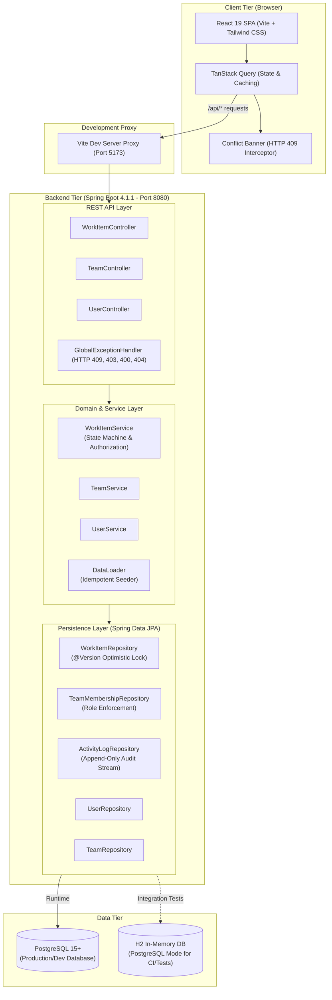

# Operations Under Pressure

An operational incident management system engineered to preserve data consistency, enforce authorization boundaries, and maintain immutable auditability during high-concurrency production triage.

[](https://github.com/srg2027/operations-under-pressure/actions/workflows/ci.yml)


---

## The Engineering Problem

During live production outages and high-severity incidents, multiple operators, team leads, and on-call engineers access operational dashboards simultaneously. Typical operations software built on standard CRUD patterns fails in subtle and dangerous ways under this pressure:

1. **The Double-Claim Race Condition:** Two engineers view an unassigned critical incident at the same moment. Both click "Claim". In a naive CRUD system lacking concurrency safeguards, the second write silently overwrites the first. Work is duplicated, communication splits, and operational ownership becomes ambiguous.
2. **Lost Updates & Stale State Overwrites:** While an engineer drafts troubleshooting notes on an incident, a team lead reassigns the ticket or escalates its priority. When the engineer saves, their stale client state clobbers the lead's update without warning.
3. **Audit Trail Mutation:** Incident response requires post-incident review (post-mortems). If comments or status changes are updated in place or can be overwritten, the timeline of who took what action, when, and under what authority is lost.
4. **Client-Side Authorization Vulnerabilities:** Relying on UI-level visibility controls to govern actions (e.g., hiding a "Reassign" button) allows any actor with API access to bypass operational protocol.

**Operations Under Pressure** addresses these failure modes directly through database-level optimistic concurrency locking (`@Version`), strict domain-enforced lifecycle transitions, append-only immutable audit logging, and server-side resource-level authorization.

---

## System Architecture

The application is structured as a decoupled client-server system: a Spring Boot 4 backend providing REST APIs backed by PostgreSQL, paired with a React 19 single-page application built on Vite and TanStack Query.



### Request Flow & Data Guarantees

1. **Client Interaction:** The user interacts with the React 19 dashboard. Requests are dispatched via TanStack Query.
2. **Reverse Proxy:** In local development, the Vite server proxies `/api/*` requests from `http://localhost:5173` to `http://localhost:8080`, bypassing browser CORS without requiring permissive server configuration.
3. **Controller Boundary:** Endpoints accept and return validated DTOs. JPA entities never escape the domain boundary.
4. **Service & Domain Layer:**
   - Validates resource-level authorization before modifying state.
   - Enforces valid state machine transitions (`OPEN` &rarr; `IN_PROGRESS` &rarr; `DONE`).
   - Atomically records every mutation into the append-only `ActivityLog`.
5. **Persistence & Concurrency:** Changes are flushed to PostgreSQL. If an entity version conflict occurs, Hibernate raises an `OptimisticLockingFailureException`, which the `GlobalExceptionHandler` translates into an HTTP `409 CONFLICT` JSON payload.
6. **Conflict Resolution:** The frontend TanStack Query mutation catches the 409, keeps the UI stable, and presents an interactive `ConflictBanner` allowing the operator to reload the latest server state without losing context.

---

## Core Correctness Behaviors

### 1. Optimistic Concurrency Control (HTTP 409 Conflict Handling)

Every `WorkItem` entity contains an internal `@Version private Long version` column managed by Hibernate.

- **How it works:** When a client fetches a work item, the current version integer is included in the representation. When any update, claim, release, reassignment, or completion request is submitted, Hibernate verifies that the version in the database matches the version read at the start of the transaction.
- **Race Condition Prevention:** If two operators attempt to claim the same item simultaneously:
  1. Operator A's transaction commits first, incrementing `version` from `0` to `1` and changing status to `IN_PROGRESS`.
  2. Operator B's transaction detects a version mismatch and raises `OptimisticLockingFailureException`.
  3. The `GlobalExceptionHandler` intercepts the exception and returns:
     ```json
     {
       "timestamp": "2026-10-18T05:00:00Z",
       "status": 409,
       "error": "Conflict",
       "message": "Work item has been modified by another user. Please reload and try again.",
       "path": "/api/work-items/2/claim"
     }
     ```
  4. The frontend catches the 409 status code and displays the `ConflictBanner` with a direct "Reload Item" action, preventing phantom states or broken workflows.

### 2. Strict Lifecycle State Machine

Work items cannot transition arbitrarily. Lifecycle transitions are strictly enforced in `WorkItemService`:

```
   ┌─────────┐         claim          ┌─────────────┐
   │         │ ─────────────────────> │             │
   │  OPEN   │                        │ IN_PROGRESS │
   │         │ <───────────────────── │             │
   └─────────┘        release         └─────────────┘
                                             │
                                             │ complete
                                             ▼
                                      ┌─────────────┐
                                      │    DONE     │
                                      └─────────────┘
```

- An item can only be claimed if its status is `OPEN`. Claiming an item already `IN_PROGRESS` or `DONE` throws an `InvalidWorkflowException` (HTTP 409).
- An item can only be released or completed if its status is `IN_PROGRESS`.
- Completed items (`DONE`) are terminal and cannot be claimed, released, or reassigned.

### 3. Server-Side Resource-Level Authorization

Authorization is checked at the business service layer on every mutating request, completely independent of the frontend UI:

- **Team Membership Verification:** An operator must be an active member of the team owning the work item to create items, claim items, or add collaboration notes.
- **Assignee vs. Team Lead Permissions:**
  - An ordinary `MEMBER` can only release, complete, reassign, or alter the priority of items **currently assigned to them**.
  - A `TEAM_LEAD` holds supervisory authority and can release, reassign, change priority, or complete **any** work item belonging to their team, regardless of current assignment.
- **Team Roster Management:** Adding a member to an existing team requires the request to be initiated by an active `TEAM_LEAD`. Member removal is restricted to a `TEAM_LEAD` or self-removal.
- **Inactive User Quarantine:** Deactivated users (`isActive = false`) are blocked from all team and work item interactions.

### 4. Append-Only Immutable Audit Log

Every operational action generates a dedicated, immutable `ActivityLog` entry within the same database transaction:

| Event Type | Recorded Data |
|---|---|
| `CREATED` | Creator identity, team assignment, initial priority |
| `CLAIMED` | Operator who claimed the incident |
| `RELEASED` | Acting user and previous assignee |
| `REASSIGNED` | Previous assignee &rarr; new assignee |
| `COMPLETED` | Resolving operator |
| `PRIORITY_CHANGED` | Previous priority &rarr; new priority |
| `NOTE_ADDED` | Exact comment text submitted by the operator |

Because audit records are created within the primary business transaction, any failure rolls back both the state mutation and the log entry, guaranteeing audit integrity with zero orphaned log records.

---

## Honest Architecture & Conscious Trade-Offs

A key goal of this project is architectural honesty. We distinguish between fully realized server-side guarantees and deliberate simulation trade-offs:

### 1. Simulated Identity vs. Real Authentication

- **The Trade-Off:** The project does not include Spring Security, OAuth2/OIDC, or password hashing. Building mock login screens or fake JWT tokens creates a false sense of security.
- **Implementation:** The frontend provides an explicit `"Who are you?"` operator picker backed by `GET /api/users?activeOnly=true`. The selected operator ID is stored in `localStorage` and sent with requests via query parameter (`?userId=...` or `?actingUserId=...`) or JSON request body.
- **Server Guarantee:** While the **identity carrier** is simulated for testability, **authorization is 100% server-enforced**. If user ID `2` attempts an action requiring user ID `1` or a `TEAM_LEAD`, the backend rejects it with HTTP `403 Forbidden` regardless of client state.

### 2. Client-Side vs. Server-Side Filtering

- **Server-Side Status Filtering:** The endpoint `GET /api/work-items?teamId={id}&status={status}` executes against PostgreSQL with an indexed query on `(team_id, status)`.
- **Client-Side Priority & Search:** Filtering by priority (`URGENT`, `HIGH`, `MEDIUM`, `LOW`) and full-text keyword search are executed in-memory on the client within the active team dataset.
- **Design Rationale:** Operational team queues typically hold dozens to hundreds of active items. In-memory client filtering provides instant, zero-latency feedback on search keystrokes and priority toggles without hammering the database. If queues grow into thousands of items, this can be evolved to Spring Data JPA Specifications with server-side pagination (`Pageable`).

### 3. Awaiting Approval Panel (Honest Unavailable State)

- The Newtonite specification mentions an "Awaiting My Approval" dashboard panel. However, the core domain model defines direct operational transitions (`OPEN` &rarr; `IN_PROGRESS` &rarr; `DONE`) without a multi-tier approval state machine.
- Rather than rendering an empty list or faking approval buttons that do not exist in the database, the dashboard renders an explicit, honest architectural notice explaining that multi-tier approvals are not part of the current domain schema.

---

## Seed Data & Evaluator Walkthrough

The application includes an automated, idempotent `DataLoader` that runs on startup when `app.seed.enabled=true` (the default). It checks existing uniqueness constraints (`findByEmail`, `findByName`) and will **never duplicate records or overwrite existing data** on restart.

### Seeded Operational Team & Identities

**Operational Team:** `Site Reliability Engineering` (*Platform observability, incident response, and mission-critical production operations*)

| Operator | Email | Role in SRE Team | Operational Capabilities |
|---|---|---|---|
| **Alice Chen** | `alice.chen@newtonite.com` | `TEAM_LEAD` | Supervisory oversight: create, claim, complete, reassign any team item, manage team roster |
| **Bob Martinez** | `bob.martinez@newtonite.com` | `MEMBER` | Operational response: create, claim open items, manage own assigned items |
| **Carol Danvers** | `carol.danvers@newtonite.com` | `MEMBER` | Operational response: create, claim open items, manage own assigned items |

### Seeded Work Items

1. **`#1` Investigate latency spike on payment gateway**  
   *Priority:* `HIGH` | *Status:* `IN_PROGRESS` | *Assignee:* Bob Martinez  
   *History:* Seeded with full audit timeline (`CREATED` by Alice, `CLAIMED` by Bob, and a collaboration note on database connection pool starvation).
2. **`#2` Mitigate Kafka consumer lag on order-events topic**  
   *Priority:* `URGENT` | *Status:* `OPEN` | *Assignee:* Unassigned  
   *History:* Immediately available for claim in the **Unassigned Urgent** panel.
3. **`#3` Renew TLS wild-card certificates on edge ingress**  
   *Priority:* `MEDIUM` | *Status:* `DONE` | *Assignee:* Alice Chen  
   *History:* Demonstrates historical completed item with full closure timeline.
4. **`#4` Optimize database query plans for activity audit log**  
   *Priority:* `LOW` | *Status:* `OPEN` | *Assignee:* Unassigned  
   *History:* Backlog triage item.

---

### 3–5 Minute Evaluator Demo Script

Follow this script to verify all core capabilities end-to-end:

1. **Launch the Application:**
   Start PostgreSQL, then run the backend (`http://localhost:8080`) and frontend (`http://localhost:5173`) using the setup instructions below.
2. **Identity Selection:**
   Open `http://localhost:5173`. Click the **"Who are you?"** identity selector and select **Bob Martinez** (`bob.martinez@newtonite.com`, Member).
3. **Dashboard Triage:**
   - Notice item `#1` (*Investigate latency spike*) appears in Bob's **Assigned to Me** panel.
   - Notice item `#2` (*Mitigate Kafka consumer lag*) appears in the **Unassigned Urgent** panel.
   - Review the **Awaiting My Approval** panel to inspect the honest architecture notice.
4. **Claim Urgent Incident:**
   Click **Claim Work Item** on item `#2` in the Unassigned Urgent panel. The item transitions immediately to `IN_PROGRESS` and moves into Bob's **Assigned to Me** queue.
5. **Add Collaboration Note & Complete Work:**
   Click into item `#1`. Scroll down to view the chronological **Activity History & Collaboration Notes** timeline. Enter a note (*"Increased connection pool size to 50"*) and click **Add Note**. Then click **Mark as Completed** to transition the item to `DONE`.
6. **Verify Lead Supervisory Override:**
   Switch active identity in the top header to **Alice Chen** (`TEAM_LEAD`). Open any item assigned to Bob. Notice Alice has full permissions to reassign or release Bob's item, whereas Bob cannot reassign Alice's items.
7. **Simulate Concurrency Conflict (HTTP 409):**
   - Open two browser tabs side-by-side to `http://localhost:5173`.
   - In Tab 1, select Alice Chen and open unassigned item `#4`.
   - In Tab 2, select Bob Martinez and open the same item `#4`.
   - In Tab 1, click **Claim Work Item**. The claim succeeds.
   - In Tab 2 (without refreshing), click **Claim Work Item**.
   - Tab 2 catches HTTP 409 and displays the **ConflictBanner** stating that the item was modified by another operator, with a one-click button to reload the updated state.

---

## Local Setup & Execution Guide

### Prerequisites

- **Java JDK:** Version 17 or higher (tested on Java 17 and Java 22)
- **Node.js:** Version 20 or higher (with `npm`)
- **PostgreSQL:** Version 14 or higher running locally on port `5432`

---

### Step 1: Database Setup

Ensure PostgreSQL is running. Create a clean database named `operations`:

```sql
-- Connect to PostgreSQL via psql or your preferred GUI client:
CREATE DATABASE operations;
```

*(Optional: If you prefer using Docker for PostgreSQL, run `docker compose up -d postgres` from the project root).*

---

### Step 2: Backend Setup & Execution

The backend uses the included Maven Wrapper (`mvnw` on Linux/macOS, `mvnw.cmd` on Windows).

#### On Windows (PowerShell):
```powershell
# Set database environment variables (adjust password if necessary)
$env:SPRING_DATASOURCE_URL="jdbc:postgresql://localhost:5432/operations"
$env:SPRING_DATASOURCE_USERNAME="postgres"
$env:SPRING_DATASOURCE_PASSWORD="your_password_here"

# Build and run the Spring Boot application
.\mvnw.cmd clean package -DskipTests
java -jar target/operations-0.0.1-SNAPSHOT.jar
```

#### On Linux / macOS (Bash):
```bash
# Set database environment variables
export SPRING_DATASOURCE_URL=jdbc:postgresql://localhost:5432/operations
export SPRING_DATASOURCE_USERNAME=postgres
export SPRING_DATASOURCE_PASSWORD=your_password_here

# Build and run the Spring Boot application
./mvnw clean package -DskipTests
java -jar target/operations-0.0.1-SNAPSHOT.jar
```

The backend starts on `http://localhost:8080`. Hibernate will automatically create all tables, indexes, and constraints, and `DataLoader` will seed the demo data.

> **Tip: Disabling Demo Data Seeding**  
> To launch against an empty database without demo seeding, set:  
> `export APP_SEED_ENABLED=false` (Bash) or `$env:APP_SEED_ENABLED="false"` (PowerShell).

---

### Step 3: Frontend Setup & Execution

In a separate terminal window:

```bash
cd frontend

# Install dependencies matching package-lock.json
npm ci

# Start the Vite development server
npm run dev
```

The frontend will be available at `http://localhost:5173`.  
All API calls to `/api/*` are automatically forwarded to `http://localhost:8080` via Vite's proxy configuration.

---

## REST API Reference

All requests and responses use JSON format (`Content-Type: application/json`).

### Users API (`/api/users`)

| Method | Endpoint | Description | Auth Constraints |
|---|---|---|---|
| `POST` | `/api/users` | Register a new user | Valid email and name |
| `GET` | `/api/users/{id}` | Retrieve user by ID | None |
| `GET` | `/api/users?activeOnly=true` | List all active users | Backs demo identity selector |

### Teams API (`/api/teams`)

| Method | Endpoint | Description | Auth Constraints |
|---|---|---|---|
| `POST` | `/api/teams` | Create operational team | Unique team name |
| `GET` | `/api/teams` | List all operational teams | None |
| `GET` | `/api/teams/{id}` | Retrieve team details | None |
| `GET` | `/api/teams/{id}/members` | List members and their roles | None |
| `POST` | `/api/teams/{id}/members?actingUserId={id}` | Add member to team | Requires `TEAM_LEAD` |
| `DELETE` | `/api/teams/{id}/members/{userId}?actingUserId={id}` | Remove member from team | `TEAM_LEAD` or self-removal |

### Work Items API (`/api/work-items`)

| Method | Endpoint | Description | Auth Constraints |
|---|---|---|---|
| `POST` | `/api/work-items` | Create new work item | Must be member of assigned team |
| `GET` | `/api/work-items/{id}` | Get work item details | None |
| `GET` | `/api/work-items?teamId={id}&status={status}` | List team items by status | Server-side status filter |
| `GET` | `/api/work-items/assigned/{userId}?status={status}` | List items assigned to user | Filter by optional status |
| `POST` | `/api/work-items/{id}/claim?userId={id}` | Claim open work item | Team member, `@Version` protected |
| `POST` | `/api/work-items/{id}/release?userId={id}` | Release item back to `OPEN` | Current assignee or `TEAM_LEAD` |
| `POST` | `/api/work-items/{id}/complete?userId={id}` | Mark item as `DONE` | Current assignee or `TEAM_LEAD` |
| `POST` | `/api/work-items/{id}/reassign` | Reassign to another member | Current assignee or `TEAM_LEAD` |
| `PATCH` | `/api/work-items/{id}/priority` | Update item priority | Current assignee or `TEAM_LEAD` |
| `POST` | `/api/work-items/{id}/notes` | Add collaboration note | Must be active team member |
| `GET` | `/api/work-items/{id}/history` | Retrieve full audit history | Chronological event stream |

---

## Verification & Test Suites

The test suite contains **81 automated tests** (70 backend tests, 11 frontend tests) and runs fully hermetically in continuous integration without requiring external dependencies.

### Backend Tests (70 Tests Passing)

Backend tests run against an in-memory H2 database operating in PostgreSQL-compatibility mode (`MODE=PostgreSQL`).

```bash
# Run the complete backend test suite:
./mvnw clean test

# Run tests and generate verification reports:
./mvnw clean verify
```

**Test Coverage Summary:**
- `OperationsApplicationTests`: Spring Boot application context load verification.
- `WorkItemServiceTest`: Concurrency race condition handling, unauthorized action rejection, state machine transition validation, release/reassign rules, note additions.
- `DataLoaderTest`: Tests first-time demo seeding, verified idempotency on repeated execution, and compatibility when launched against existing data.
- `WorkItemControllerTest`: MockMvc integration testing for claims, notes, lifecycle state changes, and error response mappings.
- `TeamControllerTest` & `UserControllerTest`: MockMvc integration for roster management, membership authorization, and user listing.
- `WorkItemRepositoryTest`, `TeamRepositoryTest`, `UserRepositoryTest`, `TeamMembershipRepositoryTest`, `ActivityLogRepositoryTest`: JPA query tests, composite uniqueness constraints, and ordering guarantees.
- `GlobalExceptionHandlerTest`: Verification of HTTP 400, 403, 404, 409, and 500 JSON translation.
- `WorkItemDtoTest`: Bean Validation constraint enforcement on input payloads.

### Frontend Tests (11 Tests Passing)

Frontend tests use Vitest and React Testing Library to verify component state, badges, conflict notifications, and user flow:

```bash
cd frontend

# Run linter
npm run lint

# Run Vitest test suite once
npm test -- --run

# Run production build
npm run build
```

**Test Coverage Summary:**
- `ConflictBanner.test.jsx`: Confirms conflict banner rendering on HTTP 409, reload action triggering, and dismissibility.
- `Dashboard.test.jsx`: Confirms dashboard panels render correctly, including the honest architectural unavailable notice for approvals.
- `StatusBadge.test.jsx`: Validates color coding and labels for `OPEN`, `IN_PROGRESS`, and `DONE`.
- `PriorityBadge.test.jsx`: Validates badge styling for `URGENT`, `HIGH`, `MEDIUM`, and `LOW`.

---

## Repository Structure

```
operations/
├── .github/
│   └── workflows/
│       └── ci.yml                 # GitHub Actions CI workflow (Backend Java 17 + Frontend Node 22)
├── src/
│   ├── main/
│   │   ├── java/com/newtonite/operations/
│   │   │   ├── activity/          # ActivityLog entity, repository, and DTOs (audit stream)
│   │   │   ├── common/            # GlobalExceptionHandler, error response DTOs, custom exceptions
│   │   │   ├── config/            # DataLoader (idempotent seed runner), WebMvc CORS configuration
│   │   │   ├── team/              # Team, TeamMembership, service, repository, and controllers
│   │   │   ├── user/              # User entity, service, repository, and controllers
│   │   │   ├── workitem/          # WorkItem entity (@Version), state machine service, controller, DTOs
│   │   │   └── OperationsApplication.java
│   │   └── resources/
│   │       └── application.properties # PostgreSQL configuration, Hibernate DDL, seed toggles
│   └── test/                      # 70 unit and integration tests across 13 test suites
├── frontend/
│   ├── src/
│   │   ├── components/            # ConflictBanner, StatusBadge, PriorityBadge, IdentitySelector, Layout
│   │   ├── context/               # UserContext (simulated identity state & localStorage sync)
│   │   ├── pages/                 # Dashboard, WorkItemList, WorkItemDetail, Teams
│   │   ├── services/              # API client methods with error normalization
│   │   └── App.jsx                # Router configuration and TanStack Query provider
│   ├── package.json
│   ├── vite.config.js             # Dev server configuration and /api proxy
│   └── vitest.config.js
├── docker-compose.yml             # Optional local PostgreSQL 15 service
├── ENGINEERING_DECISIONS.md       # Detailed technical decision records and architectural trade-offs
├── pom.xml                        # Maven dependencies (Spring Boot 4.1.1, PostgreSQL, Validation)
└── README.md                      # System documentation and developer guide
```

---

## Known Limitations & Production Roadmap

This project is built to demonstrate correctness under pressure within the scope of the challenge. The following areas represent intentional scope boundaries and natural evolution steps for a production deployment:

1. **Authentication & Session Tokens:**  
   - *Current:* Simulated operator picker stored in `localStorage`, sending user IDs via parameters.
   - *Roadmap:* Integrate Spring Security 6 with an OAuth2 / OIDC provider (e.g., Keycloak, Okta) issuing signed JWT access tokens containing user IDs and team roles in claims.
2. **Dynamic Search & Pagination:**  
   - *Current:* Server-side status filtering with client-side priority filtering and keyword search.
   - *Roadmap:* Implement Spring Data JPA `JpaSpecificationExecutor` and `Pageable` pagination to support multi-criteria search and server-side cursor pagination over millions of historical work items.
3. **Multi-Tier Approval Workflow:**  
   - *Current:* Direct operational lifecycle (`OPEN` &rarr; `IN_PROGRESS` &rarr; `DONE`).
   - *Roadmap:* Extend domain model with `PENDING_APPROVAL` status, an `ApprovalRequest` entity, and role-gated sign-off logic for high-impact production actions.
4. **Real-Time Push Updates:**  
   - *Current:* TanStack Query polling / invalidation on user actions.
   - *Roadmap:* Introduce WebSocket or Server-Sent Events (SSE) via Spring WebFlux to broadcast claim and completion events to all active dashboard sessions in real time.
